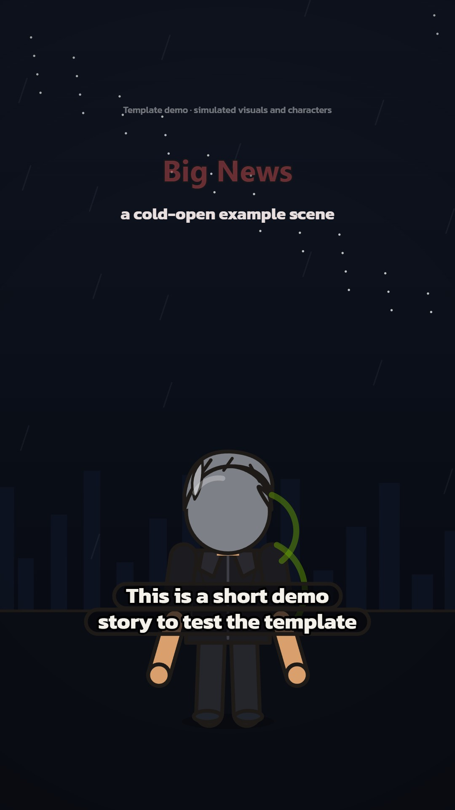
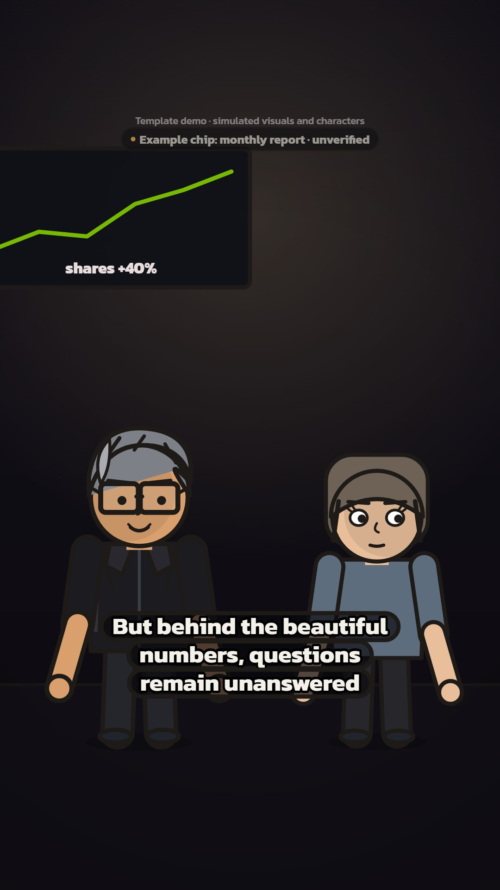
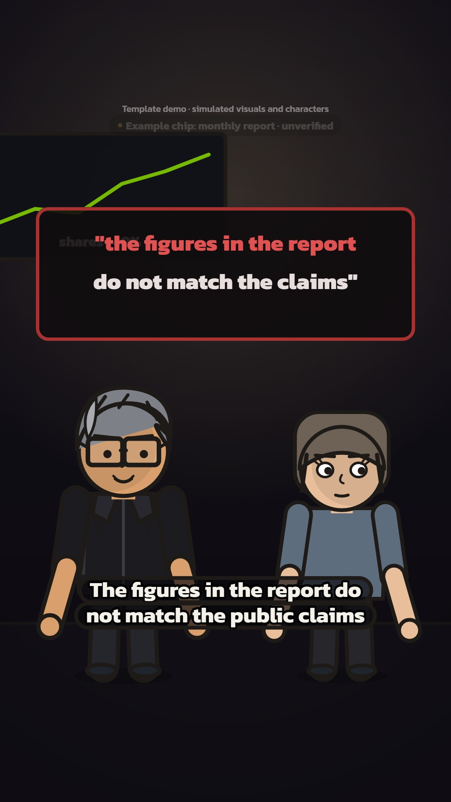
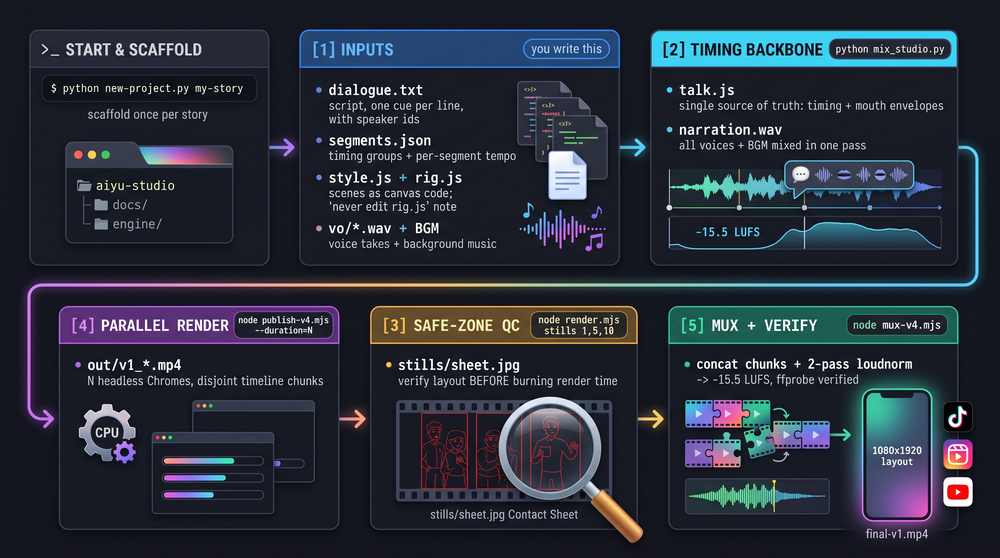

# 🎬 aiyu-studio

**[English](README.md) | [ไทย](README.th.md)**

**Video-as-code for vertical documentaries.** Write scenes in JavaScript, narrate with TTS, and render publish-ready 1080×1920 videos for Reels & TikTok — no video editor, no timeline scrubbing, no manual subtitle sync.

[](LICENSE)
[](CHANGELOG.md)
[](#requirements)
[](#contributing)

<table>
  <tr>
    <td></td>
    <td></td>
    <td></td>
  </tr>
  <tr>
    <td align="center"><sub>Cold open</sub></td>
    <td align="center"><sub>Dialogue + data card</sub></td>
    <td align="center"><sub>Closing</sub></td>
  </tr>
</table>

<sub>Every frame above is pure canvas code rendered by this template's own demo project — characters, subtitles, chart cards and all.</sub>

**▶ [Watch: ทำไมเจนเซนหวงถึงหายไป 11 วัน? — a real production made with this pipeline](https://youtu.be/dNbr5_IbYVY)** — a full Thai-language vertical documentary (the `jensen-legend` project in [examples/](examples/jensen-legend/)), demonstrating automatic Thai line-breaking subtitles, speaker-aware lip sync and the final loudness-normalized output in the wild.

## 💡 Why this exists

Vertical documentaries are repetitive to produce: sync subtitles by hand, resize for safe zones, normalize loudness, re-render everything when one line changes. This template treats a video as a **build artifact**: the script is text, the scenes are code, the timing backbone is generated — so changing one line of dialogue re-times the entire film automatically. Battle-tested through seven published iterations of a real production before extraction.

## ✨ Features

- **Single timing backbone** — `talk.js` is generated from your audio and drives scenes, subtitles and lip sync. Nothing is hand-synced, ever
- **Speaker-aware lip sync** — each character's mouth follows only their own lines, with a 30-point energy envelope per line
- **Automatic Thai line-breaking** — subtitles wrap correctly for Thai (and English, and mixed text) via `Intl.Segmenter`; punctuation never orphans onto its own line
- **Safe-zone discipline** — built-in margins keep text clear of Reels/TikTok UI overlays; QC with stills before committing to a full render
- **Parallel chunked rendering** — multiple headless Chrome processes render disjoint timeline segments simultaneously
- **Broadcast loudness** — two-pass loudnorm to −15.5 LUFS with true-peak limiting, verified by ffprobe after muxing
- **Cinematic modules (v0.2.0)** — optional `atmos.js` (multi-stop skies, atmospheric depth, living water, weather, film grain) and `people.js` (realistic walk-cycle humans), extracted from the `thai-origins` production in [examples/](examples/thai-origins/)
- **One-command scaffolding** — `new-project.py` gives you a working, renderable demo project in seconds
- **English & Thai ready** — ships with an English demo; full Thai pipeline documented with real production data

## 🏗️ How it works




<details>
<summary>🔍 <strong>View ASCII pipeline diagram</strong></summary>

```
  python new-project.py my-story ............ scaffold once per story
          |
          v
  [1] INPUTS ............................................. you write this
          dialogue.txt ....... script, one cue per line, with speaker ids
          segments.json ...... voice file -> line range groups + global tempo
          style.js + rig.js .. scenes as canvas code (never edit rig.js)
          vo/*.wav + bed.wav . voice takes + music bed (mux input)
          |
          v
  [2] TIMING BACKBONE ...................... python mix_studio.py
          talk.js ............ single source of truth: timing + mouth envelopes
          narration.wav ...... all voice files joined with gaps
          |
          v
  [3] SAFE-ZONE QC ......... node render.mjs stills 1,5,10 --page=index.html
          stills/sheet.jpg ... verify layout BEFORE burning render time
          |
          v
  [4] PARALLEL RENDER ...................... node publish-v4.mjs --duration=N
          out/v1_*.mp4 ....... N headless Chromes, disjoint timeline chunks
          |
          v
  [5] MUX + VERIFY ......................... node mux-v4.mjs
          concat chunks + 2-pass loudnorm -> -15.5 LUFS, ffprobe verified
          |
          v
      final-v1.mp4  (1080x1920, faststart)  =>  Reels / TikTok / YouTube
```

</details>

`new-project.py` scaffolds stage 1; everything downstream derives from `talk.js`.

## 🚀 Quick start

```bash
python new-project.py path/to/my-story   # scaffold a new project
cd path/to/my-story
npm install                              # playwright-core
python mix_studio.py --stub              # estimated timing — no audio needed yet
node render.mjs stills 1,5,10 --page=index.html   # then open stills/sheet.jpg
```

> **Python command:** use `py` on Windows, `python3` on macOS/Linux if `python` is not found.

If the sheet shows characters and subtitles, the pipeline works. Continue with the **[quickstart guide](docs/quickstart.md)** to produce your first full video.

## 📋 Requirements

- **Node.js** · **Python 3** · **ffmpeg** + **ffprobe** on PATH · **Chrome**
- Chrome must be installed: the scripts launch it with `channel: 'chrome'`, not a bundled Chromium
- `playwright-core` — installed via `npm install` in each project folder

## 📚 Documentation

| Document | Contents |
|---|---|
| [docs/README.md](docs/README.md) | Documentation hub + reading order |
| [docs/quickstart.md](docs/quickstart.md) | Zero to first video, step by step |
| [docs/guide-audio.md](docs/guide-audio.md) | Dialogue format, segments.json, TTS voices, tempo table |
| [docs/guide-scenes.md](docs/guide-scenes.md) | Scene writing, rig.js API, safe zones, the cam() zoom trap |
| [docs/guide-cinematic.md](docs/guide-cinematic.md) | Realistic humans, layered backgrounds, water systems, frame treatments |
| [docs/guide-map.md](docs/guide-map.md) | Animated data-driven maps: projection, flow paths, hachure mountains, city markers |
| [docs/qc-publish.md](docs/qc-publish.md) | 7-point QC, Reels/TikTok specs, AI-content disclosure |
| [docs/pipeline.md](docs/pipeline.md) | Production notes from the original real-world project |
| [examples/jensen-legend/](examples/jensen-legend/) | Complete reference implementation (code only) |
| [examples/thai-origins/](examples/thai-origins/) | Cinematic reference: animated map, realistic humans, atmosphere (code only) |
| [CHANGELOG.md](CHANGELOG.md) | Version history |

## 🧭 Core principles

1. **Everything derives from `talk.js`** — never hand-edit it; always re-run `mix_studio.py`
2. **Check safe zones with stills before every real render** — cam() zoom shifts on-screen positions
3. **Never overwrite older video versions** — always increment v1/v2/v3
4. **Never commit media** — vo/*.wav, out/, *.mp4 are covered by .gitignore

## 📁 Repository structure

```
├── new-project.py            # one-command project scaffolding
├── engine/                   # 5 reusable pipeline scripts — never edit per project
├── template/                 # project skeleton: rig.js (machinery) + style.js (your scenes) + optional atmos.js / people.js
│   └── assets/fonts/         #   Kanit 4 weights (SIL OFL)
├── docs/                     # complete guides
├── examples/                 # reference implementations: jensen-legend, thai-origins
│   ├── jensen-legend/        #   presenter format, person() mascots
│   └── thai-origins/         #   cinematic format, personTH() humans + animated map
```

## 🗺️ Roadmap

- [ ] More card types and transitions in rig.js
- [ ] Landscape (16:9) output profile
- [ ] One-command TTS generation integration
- [ ] GitHub Actions example for CI rendering

Ideas and feedback welcome — open an issue.

## 🤝 Contributing

Contributions are welcome — see [CONTRIBUTING.md](CONTRIBUTING.md) for setup, guidelines and our [Code of Conduct](CODE_OF_CONDUCT.md). Especially valuable: new rig card/scene patterns, TTS provider integrations, and documentation improvements. Please open an issue first for anything beyond a small fix so we can agree on direction. Note that `engine/` and `template/rig.js` are intentionally conservative — changes there affect every project built on this template.

## 🙏 Acknowledgements

This pipeline stands on ideas studied from these open-source projects:

- **[Yiyu5331/chibi-history-explainer](https://github.com/Yiyu5331/chibi-history-explainer)** (MIT) — the core inspiration: drawing every frame procedurally with canvas code instead of video editing, character rigs assembled from code, and the project-per-story workflow. Our system diverges deliberately: voiced narration with a generated timing backbone (rather than silent theatre), vertical 9:16, and speaker-aware lip sync — but the "video-as-code" philosophy comes from here.
- **[Yiyu5331/dafeiyu-bili-workflow](https://github.com/Yiyu5331/dafeiyu-bili-workflow)** (MIT) — reference for TTS integration and render-pipeline patterns by the same author (LLM-written scripts + TTS + vertical rendering + automated publishing).

The pipeline was then hardened through real production (`jensen-legend` v3–v7): tempo scaling, safe-zone discipline for Reels/TikTok, parallel chunk rendering, and loudness-standardized muxing are lessons paid for with actual iterations.

## 📄 License

[MIT](LICENSE) — except the bundled Kanit fonts in `template/assets/fonts/`, which are licensed under the [SIL Open Font License 1.1](template/assets/fonts/OFL.txt) by Cadson Demak.
