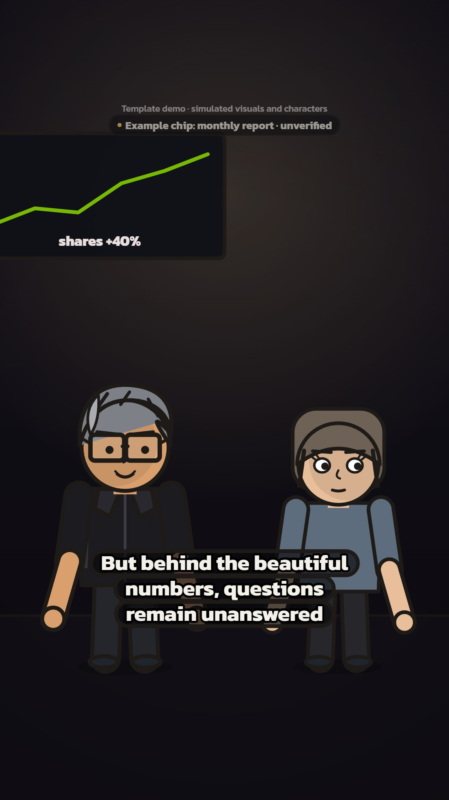

# 🎬 aiyu-studio

**[English](README.md) | [ไทย](README.th.md)**

**Video-as-code สำหรับสารคดีแนวตั้ง** — เขียนฉากด้วย JavaScript พากย์ด้วย TTS แล้วเรนเดอร์วิดีโอ 1080×1920 พร้อมลง Reels & TikTok โดยไม่ต้องเปิดโปรแกรมตัดต่อ ไม่ต้องไล่ไทม์ไลน์ ไม่ต้องซิงก์ซับมือ

[](LICENSE)
[](CHANGELOG.md)
[](#ความต้องการระบบ)

<table>
  <tr>
    <td></td>
    <td></td>
    <td></td>
  </tr>
  <tr>
    <td align="center"><sub>Cold open</sub></td>
    <td align="center"><sub>สนทนา + การ์ดข้อมูล</sub></td>
    <td align="center"><sub>ฉากปิด</sub></td>
  </tr>
</table>

<sub>ทุกเฟรมข้างบนเป็นโค้ด canvas ล้วนๆ เรนเดอร์จาก demo ของ template เอง — ทั้งตัวละคร ซับไตเติล และการ์ดกราฟ</sub>

**▶ [ดู: ทำไมเจนเซนหวงถึงหายไป 11 วัน? — งานจริงที่ผลิตด้วย pipeline นี้](https://youtu.be/dNbr5_IbYVY)** — สารคดีแนวตั้งภาษาไทยเต็มเรื่อง (โปรเจกต์ `jensen-legend` ใน [examples/](examples/jensen-legend/)) พิสูจน์การตัดบรรทัดซับไทยอัตโนมัติ ปากขยับตามผู้พูด และเสียงที่ผ่านการ normalize ตามมาตรฐานในงานจริง

## 💡 ทำไมโปรเจกต์นี้จึงมี

สารคดีแนวตั้งเป็นงานซ้ำซ้อนในการผลิต: ซิงก์ซับด้วยมือ จัด safe zone ทีละจุด normalize เสียงทีละไฟล์ และต้องเรนเดอร์ใหม่ทั้งเรื่องเมื่อแก้บทแค่บรรทัดเดียว template นี้มองวิดีโอเป็น **build artifact** — บทเป็นเท็กซ์ ฉากเป็นโค้ด timing backbone ถูก generate — ดังนั้นการแก้บทหนึ่งบรรทัดจะจับเวลาทั้งเรื่องใหม่ให้อัตโนมัติ ผ่านการทดสอบจริงมาแล้ว 7 เวอร์ชันในงาน production จริงก่อนสกัดออกมา

## ✨ ฟีเจอร์

- **Timing backbone เดียว** — `talk.js` ถูก generate จากเสียงจริงและขับฉาก ซับ และปากตัวละครทั้งหมด ไม่มีการซิงก์มือแม้แต่จุดเดียว
- **ปากขยับตามผู้พูด** — ปากของตัวละครแต่ละคนเคลื่อนตามเฉพาะบทของตัวเอง ด้วย energy envelope 30 จุดต่อบรรทัด
- **ตัดบรรทัดไทยอัตโนมัติ** — ซับตัดคำถูกต้องทั้งไทย อังกฤษ และผสมกัน ผ่าน `Intl.Segmenter` เครื่องหมายวรรคตอนไม่มีทางลอยไปขึ้นบรรทัดใหม่
- **ระบบ safe zone** — ขอบกันตายในตัวกันข้อความโดน UI ของ Reels/TikTok บัง ตรวจด้วยภาพนิ่งก่อนเรนเดอร์จริงทุกครั้ง
- **เรนเดอร์ขนานหลายโปรเซส** — headless Chrome หลายตัวเรนเดอร์ช่วงเวลาที่ไม่ซ้ำกันพร้อมกัน
- **เสียงมาตรฐาน broadcast** — loudnorm สองผ่านไปที่ −15.5 LUFS พร้อม true-peak limiting ตรวจยืนยันด้วย ffprobe หลัง mux
- **scaffold คำสั่งเดียว** — `new-project.py` ให้โปรเจกต์ demo ที่เรนเดอร์ได้จริงในไม่กี่วินาที
- **พร้อมทั้งไทยและอังกฤษ** — แนบ demo อังกฤษในตัว พร้อมเอกสาร pipeline ไทยครบจากข้อมูล production จริง

## 🏗️ การทำงาน


<details>
<summary>🔍 <strong>ดู ASCII pipeline diagram</strong></summary>

```
  python new-project.py my-story ............ scaffold ครั้งเดียวต่อเรื่อง
          |
          v
  [1] อินพุต .............................................. ส่วนที่คุณเขียน
          dialogue.txt ....... บทพูด บรรทัดละ cue พร้อมรหัสผู้พูด
          segments.json ...... กลุ่มเวลา + tempo ต่อ segment
          style.js + rig.js .. ฉากเป็นโค้ด canvas (ห้ามแก้ rig.js)
          vo/*.wav + BGM ..... เสียงพากย์ + เพลงประกอบ
          |
          v
  [2] TIMING BACKBONE ...................... python mix_studio.py
          talk.js ............ แหล่งความจริงเดียว: เวลา + envelope ปาก
          narration.wav ...... เสียงทั้งหมด + BGM mix ในผ่านเดียว
          |
          v
  [3] ตรวจ SAFE ZONE ....... node render.mjs stills 1,5,10 --page=index.html
          stills/sheet.jpg ... เช็กเลย์เอาต์ก่อนเสียเวลาเรนเดอร์จริง
          |
          v
  [4] เรนเดอร์ขนาน ......................... node publish-v4.mjs --duration=N
          out/v1_*.mp4 ....... Chrome headless N ตัว คนละช่วงเวลา
          |
          v
  [5] MUX + ตรวจยืนยัน ..................... node mux-v4.mjs
          concat + loudnorm 2 ผ่าน -> -15.5 LUFS ตรวจด้วย ffprobe
          |
          v
      final-v1.mp4  (1080x1920, faststart)  =>  Reels / TikTok / YouTube
```

</details>

`new-project.py` สร้างของในขั้น 1 ทุกอย่าง downstream สืบมาจาก `talk.js`

## 🚀 เริ่มใช้ใน 5 นาที

```bash
python new-project.py path/to/my-story   # scaffold โปรเจกต์ใหม่
cd path/to/my-story
npm install                              # playwright-core
python mix_studio.py --stub              # timing ประมาณการ — ยังไม่ต้องมีเสียง
node render.mjs stills 1,5,10 --page=index.html   # แล้วเปิด stills/sheet.jpg
```

> **คำสั่ง Python:** ใช้ `py` บน Windows หรือ `python3` บน macOS/Linux ถ้า `python` ไม่พบ

ถ้า sheet มีตัวละครกับซับแสดง pipeline ทำงานแล้ว ต่อด้วย **[คู่มือ quickstart](docs/quickstart.md)** เพื่อผลิตวิดีโอเต็มเรื่องแรก

## 📋 ความต้องการระบบ

- **Node.js** · **Python 3** · **ffmpeg** + **ffprobe** บน PATH · **Chrome**
- `playwright-core` — ติดตั้งผ่าน `npm install` ในโฟลเดอร์โปรเจกต์แต่ละเรื่อง

## 📚 เอกสาร

| เอกสาร | เนื้อหา |
|---|---|
| [docs/README.md](docs/README.md) | ศูนย์รวมเอกสาร + ลำดับการอ่าน |
| [docs/quickstart.md](docs/quickstart.md) | ศูนย์ถึงวิดีโอแรก ทีละขั้น |
| [docs/guide-audio.md](docs/guide-audio.md) | ฟอร์แมตบท, segments.json, เสียง TTS, ตาราง tempo |
| [docs/guide-scenes.md](docs/guide-scenes.md) | เขียนฉาก, API ของ rig.js, safe zone, หลุม cam() zoom |
| [docs/qc-publish.md](docs/qc-publish.md) | QC 7 ข้อ, สเปก Reels/TikTok, กฎเปิดเผยเนื้อหา AI |
| [docs/pipeline.md](docs/pipeline.md) | บันทึก production จากโปรเจกต์จริงต้นฉบับ |
| [examples/jensen-legend/](examples/jensen-legend/) | ตัวอย่าง reference implementation เต็ม (เฉพาะโค้ด) |

## 🧭 หลักการหลัก

1. **ทุกอย่างสืบจาก `talk.js`** — ห้ามแก้มือเด็ดขาด ให้รัน `mix_studio.py` ใหม่เสมอ
2. **ตรวจ safe zone ด้วยภาพนิ่งก่อนเรนเดอร์จริงทุกครั้ง** — cam() zoom ทำตำแหน่งบนจอขยับ
3. **ห้ามทับวิดีโอเวอร์ชันเก่า** — เลื่อน v1/v2/v3 เสมอ
4. **ห้าม commit มีเดีย** — vo/*.wav, out/, *.mp4 ถูกคุมโดย .gitignore แล้ว

## 📁 โครงสร้าง repo

```
├── new-project.py            # scaffold โปรเจกต์คำสั่งเดียว
├── engine/                   # สคริปต์ pipeline ใช้ซ้ำ 5 ตัว — ห้ามแก้ต่อเรื่อง
├── template/                 # โครงเรื่อง: rig.js (กลไก) + style.js (ฉากของคุณ)
│   └── assets/fonts/         #   Kanit 4 weights (SIL OFL)
├── docs/                     # คู่มือครบระบบ
└── examples/jensen-legend/   # reference implementation จริง
```

## 🗺️ Roadmap

- [ ] การ์ดและ transition เพิ่มใน rig.js
- [ ] โปรไฟล์เอาต์พุตแนวนอน (16:9)
- [ ] เชื่อม TTS generation คำสั่งเดียว
- [ ] ตัวอย่าง GitHub Actions สำหรับ CI rendering

มีไอเดียหรือ feedback ยินดีครับ — เปิด issue ได้เลย

## 🤝 การร่วมพัฒนา

ยินดีรับ contributions — ดู [CONTRIBUTING.md](CONTRIBUTING.md) สำหรับวิธีตั้งค่าและ [Code of Conduct](CODE_OF_CONDUCT.md) โดยเฉพาะ: pattern การ์ด/ฉากใหม่ใน rig, การเชื่อม TTS provider เพิ่ม และเอกสาร สำหรับอะไรที่มากกว่าแก้เล็กๆ รบกวนเปิด issue คุยทิศทางก่อน หมายเหตุ: `engine/` กับ `template/rig.js` ตั้งใจให้ conservative เพราะการเปลี่ยนตรงนั้นกระทบทุกโปรเจกต์ที่สร้างจาก template นี้

## 🙏 กิตติกรรมประกาศ

pipeline นี้ยืนอยู่บนไอเดียจากโปรเจกต์ open-source เหล่านี้:

- **[Yiyu5331/chibi-history-explainer](https://github.com/Yiyu5331/chibi-history-explainer)** (MIT) — แรงบันดาลใจหลัก: วาดทุกเฟรมด้วยโค้ด canvas แทนการตัดต่อ ตัวละครประกอบจากโค้ด และ workflow แบบหนึ่งโปรเจกต์ต่อเรื่อง ระบบของเราเบี่ยงออกโดยเจตนา: มีเสียงพากย์พร้อม timing backbone ที่ generate (แทนละครเงียบ) แนวตั้ง 9:16 และปากตามผู้พูด — แต่ปรัชญา "video-as-code" มาจากที่นี่
- **[Yiyu5331/dafeiyu-bili-workflow](https://github.com/Yiyu5331/dafeiyu-bili-workflow)** (MIT) — reference การเชื่อม TTS และ pattern ของ render pipeline จากผู้เขียนเดียวกัน

จากนั้น pipeline ถูกลับคมผ่าน production จริง (`jensen-legend` v3–v7): tempo scaling, วินัย safe zone สำหรับ Reels/TikTok, เรนเดอร์ขนานแบบ chunks และ mux ตามมาตรฐาน loudness คือบทเรียนที่จ่ายไปด้วยการ iterate จริง

## 📄 License

[MIT](LICENSE) — ยกเว้นฟอนต์ Kanit ที่แนบใน `template/assets/fonts/` ซึ่งอยู่ใต้ [SIL Open Font License 1.1](template/assets/fonts/OFL.txt) โดย Cadson Demak
