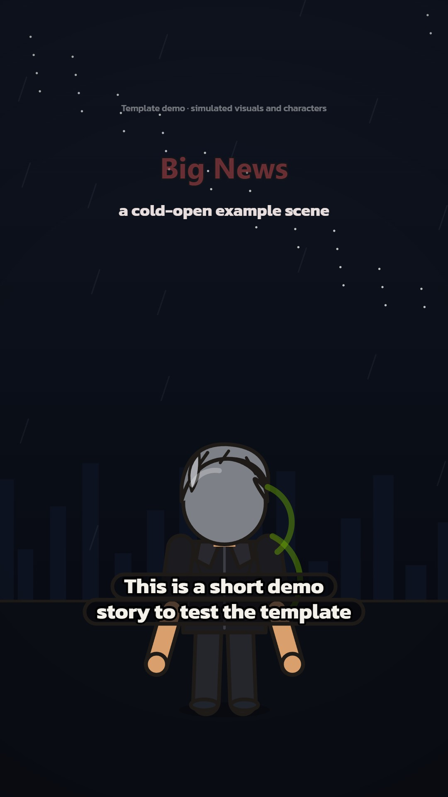
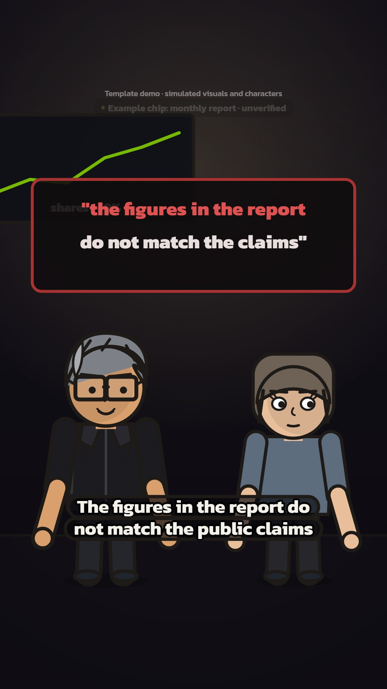
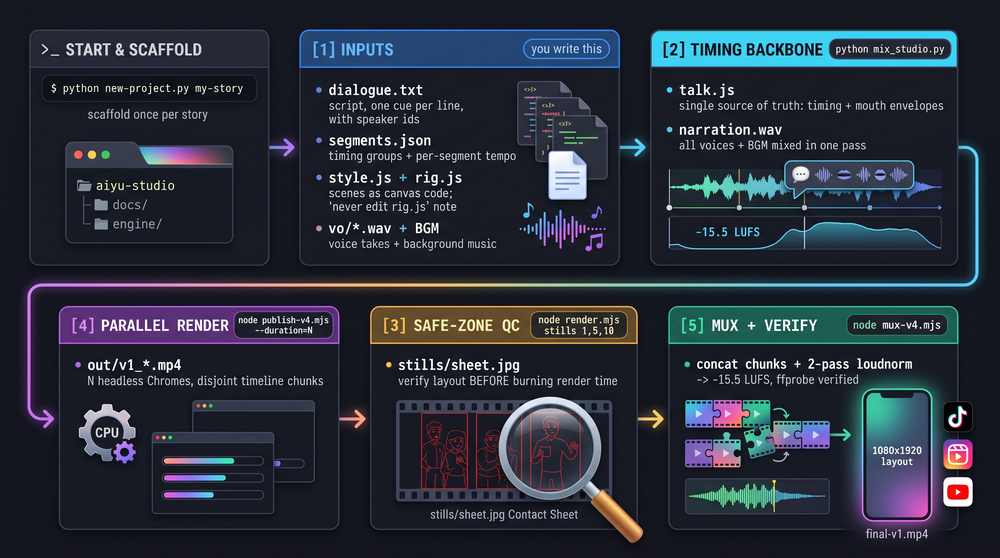

# 🎬 aiyu-studio

**[English](README.md) | [ไทย](README.th.md)**

**Video-as-code สำหรับสารคดีแนวตั้ง** — เขียนฉากด้วย JavaScript พากย์ด้วย TTS แล้วเรนเดอร์วิดีโอ 1080×1920 พร้อมลง Reels & TikTok โดยไม่ต้องเปิดโปรแกรมตัดต่อ ไม่ต้องไล่ไทม์ไลน์ ไม่ต้องซิงก์ซับมือ

[](LICENSE)
[](CHANGELOG.md)
[](#ความต้องการระบบ)

<table>
  <tr>
    <td></td>
    <td></td>
    <td></td>
  </tr>
  <tr>
    <td align="center"><sub>Cold open</sub></td>
    <td align="center"><sub>สนทนา + การ์ดข้อมูล</sub></td>
    <td align="center"><sub>ฉากปิด</sub></td>
  </tr>
</table>

<sub>ทุกเฟรมข้างบนเป็นโค้ด canvas ล้วนๆ เรนเดอร์จาก demo ของ template เอง — ทั้งตัวละคร ซับไตเติล และการ์ดกราฟ</sub>

**▶ [ดู: ทำไมเจนเซนหวงถึงหายไป 11 วัน? — งานจริงที่ผลิตด้วย pipeline นี้](https://youtu.be/dNbr5_IbYVY)** — สารคดีแนวตั้งภาษาไทยเต็มเรื่อง (โปรเจกต์ `jensen-legend` ใน [examples/legacy/](examples/legacy/jensen-legend/)) พิสูจน์การตัดบรรทัดซับไทยอัตโนมัติ ปากขยับตามผู้พูด และเสียงที่ผ่านการ normalize ตามมาตรฐานในงานจริง

## 💡 ทำไมโปรเจกต์นี้จึงมี

สารคดีแนวตั้งเป็นงานซ้ำซ้อนในการผลิต: ซิงก์ซับด้วยมือ จัด safe zone ทีละจุด normalize เสียงทีละไฟล์ และต้องเรนเดอร์ใหม่ทั้งเรื่องเมื่อแก้บทแค่บรรทัดเดียว template นี้มองวิดีโอเป็น **build artifact** — บทเป็นเท็กซ์ ฉากเป็นโค้ด timing backbone ถูก generate — ดังนั้นการแก้บทหนึ่งบรรทัดจะจับเวลาทั้งเรื่องใหม่ให้อัตโนมัติ ผ่านการทดสอบจริงมาแล้ว 7 เวอร์ชันในงาน production จริงก่อนสกัดออกมา

## ✨ ฟีเจอร์

- **Timing backbone เดียว** — `talk.js` ถูก generate จากเสียงจริงและขับฉาก ซับ และปากตัวละครทั้งหมด ไม่มีการซิงก์มือแม้แต่จุดเดียว
- **พรีวิวสดแบบ scrub ได้** — เปิด `preview.html` ในเบราว์เซอร์ได้เลย (ไม่ต้องมี server) แล้วลากดูทั้งเรื่องแบบเรียลไทม์ผ่าน render path เดียวกับของจริง: waveform timeline, หมุดแยกบรรทัด/ฉาก, คีย์ลัดควบคุมการเล่น, loop A-B และเมนูกระโดดตามฉาก เจอปัญหาเลย์เอาต์ก่อนเสียเวลาเรนเดอร์แม้แต่เฟรมเดียว
- **ปากขยับตามผู้พูด** — ปากของตัวละครแต่ละคนเคลื่อนตามเฉพาะบทของตัวเอง ด้วย energy envelope 30 จุดต่อบรรทัด
- **ตัดบรรทัดไทยอัตโนมัติ** — ซับตัดคำถูกต้องทั้งไทย อังกฤษ และผสมกัน ผ่าน `Intl.Segmenter` เครื่องหมายวรรคตอนไม่มีทางลอยไปขึ้นบรรทัดใหม่
- **การ์ดเด้งแบบสปริง** — การ์ดและ pop-in เคลื่อนด้วยฟิสิกส์สปริงแท้ ทุก curve เป็น pure function deterministic ปลอดภัยกับการเรนเดอร์ขนาน
- **ระบบ safe zone** — ขอบกันตายในตัวกันข้อความโดน UI ของ Reels/TikTok บัง ตรวจสดใน preview แล้วยืนยันด้วยภาพนิ่งก่อนเรนเดอร์จริงทุกครั้ง
- **เรนเดอร์ขนานหลายโปรเซส** — headless browser หลายตัวเรนเดอร์ช่วงเวลาที่ไม่ซ้ำกันพร้อมกัน
- **เสียงมาตรฐาน broadcast** — loudnorm สองผ่านไปที่ −15.5 LUFS พร้อม true-peak limiting ตรวจยืนยันด้วย ffprobe หลัง mux
- **โมดูล cinematic** — `features/atmosphere.js` (ท้องฟ้าหลายชั้น มุมมองลึกด้วยสี น้ำมีชีวิต อากาศ/ฟิล์มเกรน) และ `features/people.js` (ตัวละครมนุษย์สัดส่วนจริงเดินได้) แยกมาจากโปรดักชัน `thai-origins` ใน [examples/legacy/](examples/legacy/thai-origins/)
- **Chrome หรือ Chromium ก็ได้** — engine เลือกเบราว์เซอร์ให้อัตโนมัติ ไม่จำเป็นต้องมี Chrome
- **มีเทส** — pyramid ทั้ง unit + end-to-end โดยไม่เพิ่ม dependency เลย determinism ถูกบังคับด้วย hash ไม่ใช่ความหวัง
- **scaffold คำสั่งเดียว** — `new-project.py` ให้โปรเจกต์ demo ที่เรนเดอร์ได้จริงในไม่กี่วินาที
- **agent skills ในทุกโปรเจกต์** — กฎฉบับย่อ (`aiyu-authoring` / `aiyu-pipeline` / `aiyu-cinematic`) ถูก scaffold ไปใน `skills/` เสมอ coding agent เขียนโค้ดฉากถูกตั้งแต่พรอมป์แรก แทนที่จะค่อย ๆ เรียนรู้กฎจากความผิดพลาด
- **auto-segmentation แบบ optional** — `tools/auto-segment` ร่าง `segments.json` และตัดไฟล์เสียงย่อยจากเสียงยาวไฟล์เดียวต่อผู้พูดด้วย whisper word-alignment วิถี manual เดิมยังเป็น first-class เต็มตัว

## 🏗️ การทำงาน



<details>
<summary>🔍 <strong>ดู ASCII pipeline diagram</strong></summary>

```
  python new-project.py my-story ............ scaffold ครั้งเดียวต่อเรื่อง
          |
          v
  [1] อินพุต ......................................... ส่วนที่คุณเขียน
          story/dialogue.txt ... บทพูด บรรทัดละ cue พร้อมรหัสผู้พูด
          story/segments.json .. กลุ่ม ไฟล์เสียง → ช่วงบรรทัด + tempo รวม
          story/style.js ....... ฉากเป็นโค้ด canvas บน core/ + features/
          vo/*.wav + bed.wav ... เสียงพากย์ + เพลงประกอบ อยู่ที่ root โปรเจกต์
          |
          v
  [2] TIMING BACKBONE ...................... npm run stub / npm run mix
          talk.js ............ แหล่งความจริงเดียว: เวลา + envelope ปาก
          narration.wav ...... ต่อไฟล์เสียงทั้งหมดพร้อมช่วงเงียบ
          |
          v
  [3] ตรวจเลย์เอาต์ ........ preview.html (scrub สด) + npm run stills
          stills/sheet.jpg ... เช็กเลย์เอาต์ก่อนเสียเวลาเรนเดอร์จริง
          |
          v
  [4] เรนเดอร์ขนาน ......................... npm run publish -- --chunks=N
          out/v1_*.mp4 ....... browser headless N ตัว คนละช่วงเวลา
          |
          v
  [5] MUX + ตรวจยืนยัน ..................... npm run mux
          concat + loudnorm 2 ผ่าน -> -15.5 LUFS ตรวจด้วย ffprobe
          |
          v
      final-v1.mp4  (1080x1920, faststart)  =>  Reels / TikTok / YouTube
```

</details>

`new-project.py` สร้างของในขั้น 1 ทุกอย่าง downstream สืบมาจาก `talk.js`

## 🚀 เริ่มใช้ใน 5 นาที

```bash
python new-project.py path/to/my-story   # scaffold โปรเจกต์ใหม่
cd path/to/my-story
npm ci                                   # playwright-core (locked)
npm run stub                             # timing ประมาณการ — ยังไม่ต้องมีเสียง
npm run stills -- 1,5,10                 # แล้วเปิด stills/sheet.jpg
```

> **คำสั่ง Python:** ใช้ `py` บน Windows หรือ `python3` บน macOS/Linux ถ้า `python` ไม่พบ

ถ้า sheet มีตัวละครกับซับแสดง pipeline ทำงานแล้ว — หรือเปิด `preview.html` ลากดู demo สดได้เลย ต่อด้วย **[คู่มือ quickstart](docs/getting-started/01-quickstart.md)** เพื่อผลิตวิดีโอเต็มเรื่องแรก

## 📋 ความต้องการระบบ

- **Node.js 20+** · **Python 3** · **ffmpeg** + **ffprobe** บน PATH
- **Chrome หรือ Chromium** — engine ลอง Chrome ที่ติดตั้งไว้ก่อน ตามด้วย headless shell ของ playwright แล้วจึง chromium build เต็ม (`npx playwright-core install chromium`) หรือชี้ binary เองด้วย env `CHROME_PATH` / `--browser=path`
- `playwright-core` — ติดตั้งด้วย `npm ci` ในโฟลเดอร์โปรเจกต์แต่ละเรื่อง

## 📚 เอกสาร

| เอกสาร | เนื้อหา |
|---|---|
| [docs/README.md](docs/README.md) | ศูนย์รวมเอกสาร + ลำดับการอ่าน |
| [docs/getting-started/01-quickstart.md](docs/getting-started/01-quickstart.md) | ศูนย์ถึงวิดีโอแรก ทีละขั้น |
| [docs/authoring/01-scenes.md](docs/authoring/01-scenes.md) | เขียนฉาก, API ของ runtime, safe zone, หลุม cam() zoom |
| [docs/authoring/02-dialogue-audio.md](docs/authoring/02-dialogue-audio.md) | ฟอร์แมตบท, segments.json, เสียง TTS, ตาราง tempo |
| [docs/authoring/03-cinematic.md](docs/authoring/03-cinematic.md) | ตัวละครมนุษย์สมจริง ฉากหลังหลายชั้น ระบบน้ำ และ frame treatment |
| [docs/authoring/04-maps.md](docs/authoring/04-maps.md) | แผนที่แอนิเมชันจากข้อมูลจริง: projection, flow path, ภูเขาแบบ hachure, จุดเมือง |
| [docs/authoring/05-parameterized.md](docs/authoring/05-parameterized.md) | parameterized rendering — วิดีโอหลาย variant จากโปรเจกต์เดียว |
| [docs/delivery/01-qc-publish.md](docs/delivery/01-qc-publish.md) | QC 7 ข้อ, สเปก Reels/TikTok, กฎเปิดเผยเนื้อหา AI |
| [docs/testing/README.md](docs/testing/README.md) | test pyramid — กลยุทธ์, unit, e2e, CI |
| [docs/examples/README.md](docs/examples/README.md) | โบราณคดี production + บันทึกของทั้งสองเรื่องจริง |
| [examples/legacy/jensen-legend/](examples/legacy/jensen-legend/) | ตัวอย่าง reference implementation เต็ม (เฉพาะโค้ด) |
| [examples/legacy/thai-origins/](examples/legacy/thai-origins/) | ตัวอย่างสไตล์ cinematic: แผนที่แอนิเมชัน ตัวละครสมจริง บรรยากาศ (เฉพาะโค้ด) |
| [CODEBASE.md](CODEBASE.md) | แผนที่ repo ฉบับ 5 นาที |
| [AGENTS.md](AGENTS.md) | กฎ 5 ข้อของการพัฒนา — อ่านก่อน contribute |
| [CHANGELOG.md](CHANGELOG.md) | ประวัติเวอร์ชัน |

## 🧭 หลักการหลัก

1. **ทุกอย่างสืบจาก `talk.js`** — ห้ามแก้มือเด็ดขาด ให้รัน mix ใหม่เสมอ (`npm run mix` / `npm run stub`)
2. **scrub ใน `preview.html` ก่อน แล้วยืนยันด้วยภาพนิ่งก่อนเรนเดอร์จริงทุกครั้ง** — cam() zoom ทำตำแหน่งบนจอขยับ
3. **ห้ามทับวิดีโอเวอร์ชันเก่า** — เลื่อน v1/v2/v3 เสมอ
4. **ห้าม commit มีเดีย** — vo/*.wav, out/, *.mp4 ถูกคุมโดย .gitignore แล้ว

## 📁 โครงสร้าง repo

```
├── new-project.py            # scaffold โปรเจกต์คำสั่งเดียว
├── engine/                   # สคริปต์ pipeline (thin shells) + lib/ (logic รวมทั้งหมด)
├── template/                 # โครงเรื่องที่ผู้ใช้ได้รับ
│   ├── core/                 #   runtime kernel — primitives, registry, motion, camera (ห้ามแก้)
│   ├── features/             #   character/subtitles/environment/cards/atmosphere/people (ห้ามแก้)
│   ├── story/                #   ส่วนที่เขียนเอง: style.js, dialogue.txt, segments.json, srchips.js
│   ├── preview.html          #   live scrubber — ไม่ต้องมี server
│   ├── skills/               #   agent skills: aiyu-authoring / aiyu-pipeline / aiyu-cinematic
│   └── assets/fonts/         #   Kanit 4 weights (SIL OFL)
├── tests/                    # pyramid unit + e2e (ไม่ถูก copy ไปในโปรเจกต์)
├── tools/auto-segment/       # ตัวช่วย draft segments.json ด้วย whisper (optional มี deps ของตัวเอง ไม่ถูก scaffold)
├── docs/                     # ระบบเอกสาร — โฟลเดอร์ตามหมวด ไฟล์ numbered
├── examples/
│   ├── active/               # production อนาคตบนสถาปัตยกรรมปัจจุบัน
│   └── legacy/               # production จริงแช่แข็งตามยุคของมัน (jensen-legend, thai-origins)
```

## 🗺️ Roadmap

- [ ] การ์ดและ transition เพิ่มใน runtime
- [ ] โปรไฟล์เอาต์พุตแนวนอน (16:9)
- [ ] เชื่อม TTS generation คำสั่งเดียว
- [ ] ตัวอย่างการเรนเดอร์วิดีโอบน CI

มีไอเดียหรือ feedback ยินดีครับ — เปิด issue ได้เลย

## 🤝 การร่วมพัฒนา

ยินดีรับ contributions — ดู [CONTRIBUTING.md](CONTRIBUTING.md) สำหรับวิธีตั้งค่าและ [Code of Conduct](CODE_OF_CONDUCT.md) โดยเฉพาะ: pattern การ์ด/ฉากใหม่สำหรับ runtime, การเชื่อม TTS provider เพิ่ม และเอกสาร สำหรับอะไรที่มากกว่าแก้เล็กๆ รบกวนเปิด issue คุยทิศทางก่อน หมายเหตุ: `engine/` กับ `template/core/` + `template/features/` ตั้งใจให้ conservative เพราะการเปลี่ยนตรงนั้นกระทบทุกโปรเจกต์ที่สร้างจาก template นี้ และ verification gate ใน [AGENTS.md](AGENTS.md) มีผลบังคับ

## 🙏 กิตติกรรมประกาศ

pipeline นี้ยืนอยู่บนไอเดียที่ศึกษาจากงาน open-source — ตรงที่สุดคือ **[Yiyu5331/chibi-history-explainer](https://github.com/Yiyu5331/chibi-history-explainer)** (ปรัชญา "video-as-code" และ workflow หนึ่งโปรเจกต์ต่อเรื่อง) และ **[motion-canvas](https://github.com/motion-canvas/motion-canvas)** (master-clock player และ spring physics — นำมาใช้ในรูป closed-form pure function โดยเจตนาเบี่ยงจาก simulation ที่มี state เพื่อให้ parallel rendering deterministic) ไม่มีโค้ดของใครถูก copy มาเลย — สิ่งที่เดินทางมาคือไอเดีย บวกกับความรู้เชิงลบอันมีค่า: แนวทางที่ศึกษาแล้วตัดทิ้ง

ประวัติเต็ม — อะไรถูกนำมาใช้ อะไรถูกตัดทิ้ง และเพราะอะไร — อยู่ใน **[docs/acknowledgements.md](docs/acknowledgements.md)**

จากนั้น pipeline ถูกลับคมผ่าน production จริง (`jensen-legend` v3–v7): tempo scaling, วินัย safe zone สำหรับ Reels/TikTok, เรนเดอร์ขนานแบบ chunks และ mux ตามมาตรฐาน loudness คือบทเรียนที่จ่ายไปด้วยการ iterate จริง

## 📄 License

[MIT](LICENSE) — ยกเว้นฟอนต์ Kanit ที่แนบใน `template/assets/fonts/` ซึ่งอยู่ใต้ [SIL Open Font License 1.1](template/assets/fonts/OFL.txt) โดย Cadson Demak
